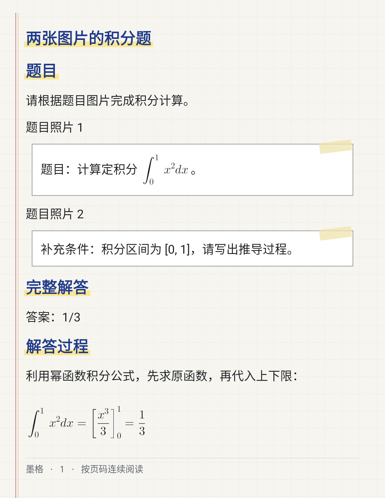

# 墨格 0.2.3 · 交互与图片分享修改报告

日期：2026-10-02。版本：0.2.3，versionCode 5。

## 已完成

- 对话页移除三点菜单。新对话直接显示历史与设置图标，已有会话显示新建与设置图标；创建第一条消息后按真实会话身份切换。题册保留独立入口。顶部标题限定一行，避免长标题挤压导航。
- 相机实际拍摄方向驱动闪光灯、水平仪和相册图标的 240ms 转动。自动横竖屏时先补偿画布变化，再平滑回正；锁定屏幕时按实际拍摄方向补偿。使用最短路径和临界角度回差，传感器仅在前台监听，关闭系统动画时直接切换。旋转仍复用既有 CameraX 用例。
- 答案优先模式改为稿纸折边：虚线折痕、胶带色折角、方向提示，以及展开/收起的高度和淡入淡出动画。完整解答来自当前已保存回答，不重新请求模型。保留触控尺寸、无障碍状态和关闭动效支持。
- 分享预览按每张图片隔离加载状态，不再立即 recycle 已交给 Compose 的 Bitmap；旧绘制帧仍可安全使用旧图片。迟到解码不能覆盖当前页，缺失图片提供明确提示，题目照片完整适配固定高度，切换不再引起按钮跳动。
- 分享界面沿用当前稿纸/黑板主题，补齐黑板模式文字颜色，导出范围卡片保留选择状态语义。长图使用应用的浅色稿纸、墨蓝标题、荧光笔、红色页边线、浅方格、照片边框与胶带；保留公式、宽表格、图形、页码与长图分页。

## 闪退链路与回归

修复后验证了延迟读取第二张、立即跳到第三张、旧绘制帧保留图片，以及三张题目图片多次前后切换。还验证了相机自动旋转中间帧、方向锁定与回差、稿纸展开/收起中间高度、关闭动效直接展示、顶部新旧会话图标和黑板主题正文颜色。

## 安装文件

SHA-256：`0CEB3AB264DE63898AEF5B303A1C525B9925B32344F2D01C6AD5D4EAF08FAB33`。

## 更新状态

[公开源码仓库](https://github.com/fxx255/moge) 和分支自动检查已启用。应用具有版本检查、下载验证与系统安装流程，但当前开发签名版本关闭应用内更新；仓库尚无正式 Release。仅推送源码不会向已安装应用发布更新。

正式更新需配置专用长期签名和 github-release Secrets，并发布匹配版本的正式标签，由工作流生成 APK 与 update.json。启用后应用提示新版本，用户选择下载，最终安装由系统确认。此次没有推送发布标签或将开发签名 APK 作为正式更新包发布。详细流程见 [GitHub 分发与应用更新](github-release.md)。

## 样图与分工

以下图片由应用原生导出器实际生成，输入是测试创建的两张题目图片，不含真实用户照片。

相机初稿由 dsh 协助；任务因余额不足中断，后续接口补齐、自动旋转补偿、回差处理及全部审查验证由协调者完成。
